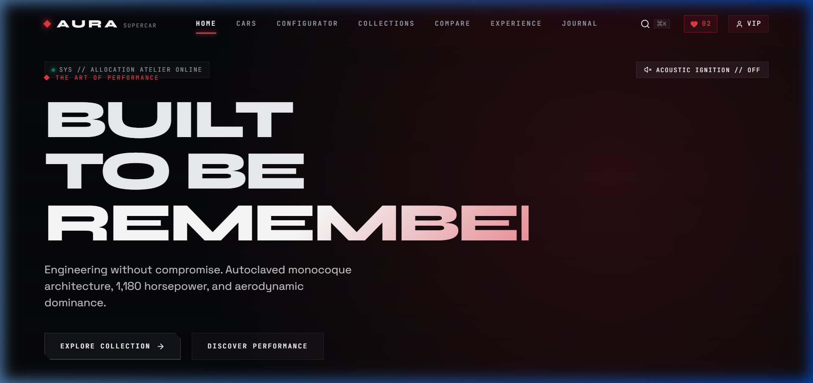
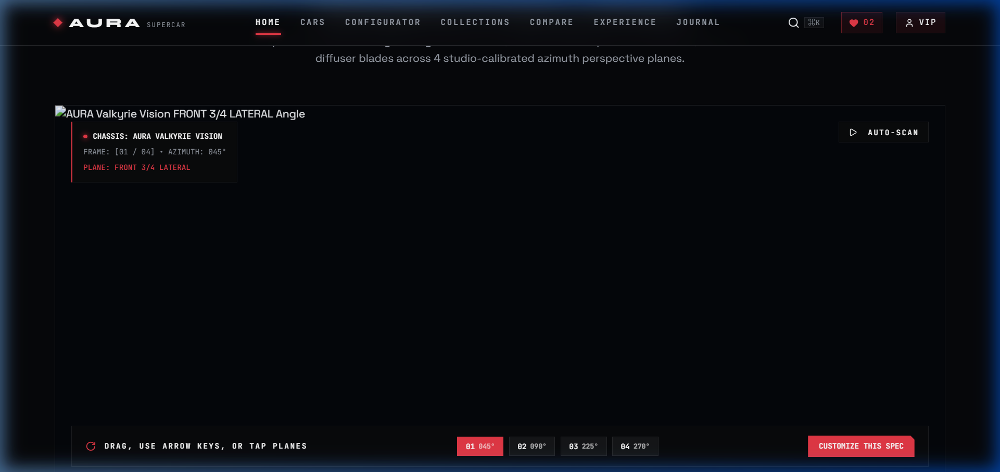
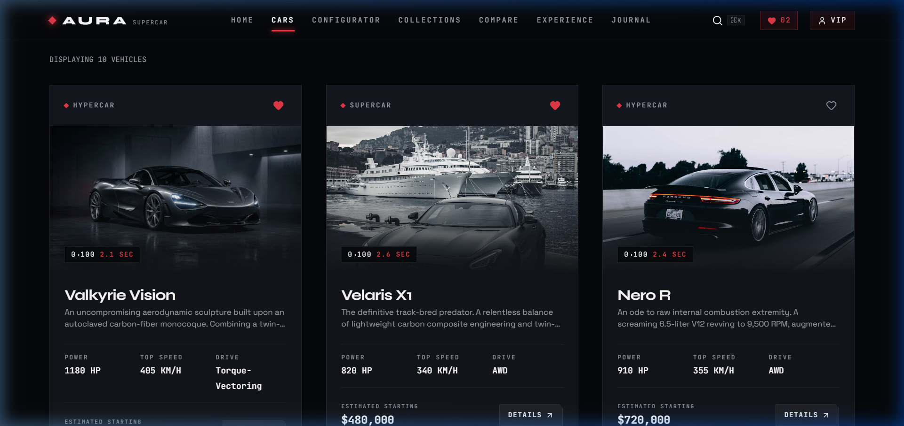
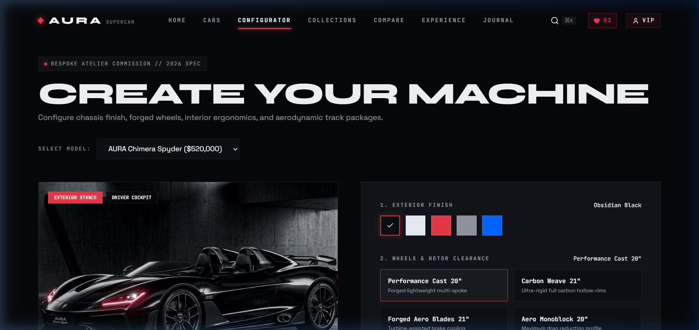
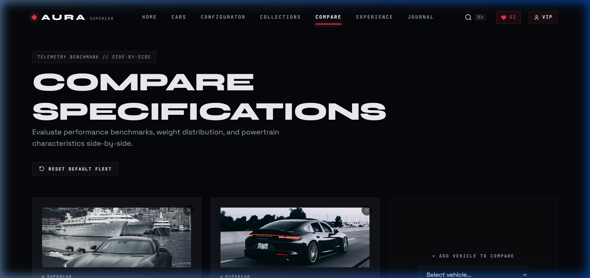
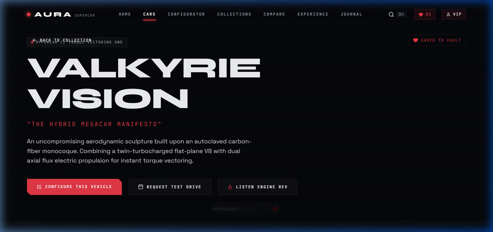
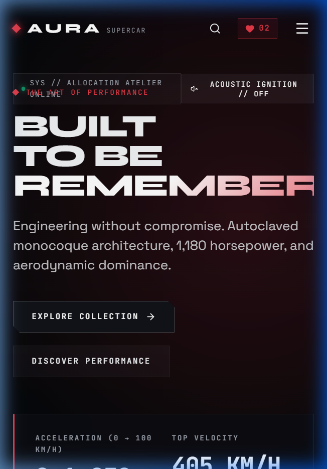

# 🏎️ AURA Supercar Digital Showroom & Atelier

[](https://react.dev/)
[](https://vitejs.dev/)
[](https://reactrouter.com/)
[](https://www.framer.com/motion/)
[](https://developer.mozilla.org/en-US/docs/Web/API/Web_Audio_API)
[](#-design-system--tokens)

> **A cutting-edge digital automotive showroom, bespoke hypercar configurator, and telemetry proving ground atelier.**  
> Crafted with React 19, Vite, Framer Motion, and procedural Web Audio synthesis under the *Kinetic Obsidian* luxury design system. Delivers multi-azimuth exterior inspection, real-time dyno telemetry benchmarks, side-by-side spec comparisons, bespoke commission customization, and client allocation record keeping.

---

## 📑 Table of Contents

1. [Project Overview](#-project-overview)
2. [Project Objectives](#-project-objectives)
3. [Key Verified Features](#-key-verified-features)
4. [Technology Stack](#-technology-stack)
5. [System Architecture & Folder Structure](#-system-architecture--folder-structure)
6. [Installation & Setup](#-installation--setup)
7. [Development, Build, and Preview Commands](#-development-build-and-preview-commands)
8. [Application Routes Directory](#-application-routes-directory)
9. [Core Workflows](#-core-workflows)
10. [Data Model & LocalStorage Persistence](#-data-model--localstorage-persistence)
11. [Demo Authentication & Security Scope](#-demo-authentication--security-scope)
12. [Visual Showcase & Screenshots](#-visual-showcase--screenshots)
13. [Deployment Instructions & SPA Fallback](#-deployment-instructions--spa-fallback)
14. [Known Limitations](#-known-limitations)
15. [Future Roadmap](#-future-roadmap)
16. [Resume-Ready Project Summary](#-resume-ready-project-summary)

---

## 🌟 Project Overview

**AURA Supercar Digital Showroom** bridges high-end automotive design aesthetics with high-performance frontend engineering. Built as an elite portfolio project for engineering interviews and automotive UI/UX demonstrations, it replaces conventional e-commerce layouts with a cyber-luxury digital atelier experience.

- **Tactile Micro-Interactions**: Custom inertia-damped dual cursor, chamfered edge geometry, and 3D pointer tilts.
- **Synthesized Acoustic Engine**: Pure mathematical sound generation via Web Audio API—recreating authentic V8/V12 internal combustion rumbles, throttle surges, and turbo flutter with zero MP3/WAV dependencies.
- **Bespoke Atelier Configurator**: Interactive chassis paint shader simulation, forged rim selections, cockpit ergonomics, and live commission price interpolation.
- **Head-to-Head Telemetry Comparison**: Side-by-side dynamic benchmark matrix comparing horsepower, torque, top speed, and 0–100 km/h with automated best-in-class badging.
- **Zero Horizontal Overflow**: Fluid responsive layouts verified across 320px, 375px, 768px, 1024px, and 1440px viewports.

---

## 🎯 Project Objectives

- **Portfolio-Grade Engineering**: Demonstrate clean React 19 component patterns, decoupled context state, predictable route synchronization, and safe data handling.
- **High-Impact Visual Design**: Adhere strictly to the *Kinetic Obsidian* aesthetic token system (`#06070a` void black, `#14171e` elevated obsidian, `#ff3847` kinetic crimson, and `#8e939c` WCAG AA compliant muted typography).
- **Resilience Against Bad State**: Ensure zero crashes when handling invalid route IDs, empty comparison matrices, corrupted LocalStorage entries, or unhandled gestures.
- **Zero External Audio Dependencies**: Eliminate network latency and asset licensing issues by synthesizing all engine sounds procedurally.

---

## ⚡ Key Verified Features

### 1. Cinematic Showroom & Calibrated Multi-Azimuth Viewer
- **Studio-Calibrated Exterior Perspective Canvas**: Inspect authentic aerodynamic ground-effects, carbon monocoque venturi tunnels, and rear diffuser blades across 4 studio-calibrated azimuth perspective planes (`045°` Bow, `090°` Profile, `225°` Quarter, `270°` Stern).
- **Auto-Scan Azimuth Mode**: One-click smooth orbital scan cycling between calibrated telemetry planes with play/pause state indicator.
- **Preloaded Zero-Latency Transition**: Automatic background preloading of high-resolution perspective frames eliminates blank flashes and layout shifts.
- **Engineering Architecture Transparency**: Explicit engineering disclaimer detailing that continuous 12–24 frame turntable rotation is reserved for 3D GLTF / WebGL asset pipelines to prevent 2D generative AI geometry drift.
- **Dyno Drive Mode Switcher**: Toggle between `Stealth`, `Corsa`, and `Overboost` presets with dynamic HUD dial feedback.
- **Scroll-Linked Storytelling**: Staggered typography, telemetry status lines, and technical specification highlights.

### 2. Procedural Web Audio Engine
- **Mathematical Sound Synthesis**: Utilizes `sawtooth`, `triangle`, and `sine` `OscillatorNode` instances routed through resonant `BiquadFilterNode` filters.
- **Race-Condition Protected Lifecycle**: Cancelable stop timeouts and teardown routines prevent node leakage and audio clipping during rapid toggling.
- **User Gesture Resumption**: Auto-resumes suspended audio contexts following browser autoplay security policies.

### 3. Bespoke Atelier Configurator (`/configurator/:id`)
- **Route Parameter Synchronization**: Directly load any vehicle model (e.g. `/configurator/nero-r`) with synchronized pricing and options.
- **Specular Paint Shader Simulation**: Real-time metallic paint overlay blending with exterior and cockpit interior perspective toggles.
- **Commission Persistence**: Save customized specifications into the collector's vault with celebratory particle feedback (`canvas-confetti`).
- **Invalid ID Handling**: Gracefully detects unrecognized route IDs and presents an informative banner while loading the default flagship specification.

### 4. Side-by-Side Comparison Matrix (`/compare`)
- **Telemetry Benchmarks**: Evaluates horsepower, torque, 0–100 km/h acceleration, and top speed across up to 3 vehicles.
- **Safeguarded Bounds**: Prevents `-Infinity` / `NaN` evaluation when comparisons are empty or contain single vehicles.
- **Empty State & Quick Reset**: Provides a clean empty state with one-click restoration of the default comparison pair (`Velaris X1` vs `Nero R`).

### 5. Instant Fleet Search (`Ctrl+K` / `Cmd+K`)
- **Global Keyboard Shortcut**: Universal access via `Ctrl+K` (Windows/Linux) and `Cmd+K` (macOS), ignoring active input editing.
- **Real-Time Fleet Filtering**: Search vehicles by model name, category, engine type, or aerodynamic features.

### 6. Private Allocation Test Drive Modal
- **Accessible Modal Dialog**: Full keyboard trap with `Escape` key dismissal, backdrop dismiss, and body scroll lock cleanup.
- **Multi-Field Validation**: Client legal name, private email, telephone, and preferred atelier location booking.

---

## 🏎️ Verified 10-Vehicle Fleet Specification Matrix

The atelier fleet consists of ten distinctive, high-fidelity machines across five performance classes (two models per category):

| Model Name | ID | Category | Powertrain / Architecture | Output | 0–100 km/h | Top Speed | Base Price |
| :--- | :--- | :--- | :--- | :--- | :--- | :--- | :--- |
| **AURA Valkyrie Vision** | `valkyrie-vision` | Hypercar | 4.0L Twin-Turbo Flat-Plane V8 + Dual Axial Flux | 1,180 HP / 1,150 Nm | 2.1s | 405 km/h | $1,250,000 |
| **AURA Nero R** | `nero-r` | Hypercar | 6.5L Naturally Aspirated V12 + KERS Supercapacitor | 910 HP / 880 Nm | 2.4s | 355 km/h | $720,000 |
| **AURA Velaris X1** | `velaris-x1` | Supercar | 4.0L Twin-Turbo V8 + E-Diff AWD | 820 HP / 920 Nm | 2.6s | 340 km/h | $480,000 |
| **AURA Chimera Spyder** | `chimera-spyder` | Supercar | 4.0L Twin-Turbo Flat-Plane V8 Roadster | 840 HP / 890 Nm | 2.7s | 335 km/h | $520,000 |
| **AURA Aurelia GT** | `aurelia-gt` | Grand Tourer | 4.2L Twin-Turbo V8 Continental Fastback | 760 HP / 900 Nm | 2.9s | 325 km/h | $410,000 |
| **AURA Spectre SB** | `spectre-sb` | Grand Tourer | 4.4L Twin-Turbo V8 Mild-Hybrid Shooting Brake | 780 HP / 940 Nm | 2.8s | 330 km/h | $460,000 |
| **AURA Stratos RS** | `stratos-rs` | Track Machine | 3.8L Twin-Turbo Flat-6 Pure RWD Apex Hunter | 680 HP / 770 Nm | 3.0s | 310 km/h | $365,000 |
| **AURA Apex-0** | `apex-zero` | Track Machine | 5.2L Naturally Aspirated V10 Race-Spec (Dorsal Fin) | 960 HP / 980 Nm | 2.3s | 360 km/h | $890,000 |
| **AURA Solstice EV** | `solstice-ev` | Electric Performance | Quad Axial Flux Motors + 800V SiC Inverter | 1,020 HP / 1,350 Nm | 2.2s | 350 km/h | $540,000 |
| **AURA Pulsar EV** | `pulsar-ev` | Electric Performance | Stator-Cooled Quad Axial Flux Hypercar | 1,280 HP / 1,500 Nm | 1.9s | 412 km/h | $1,100,000 |

---

## 🛠️ Technology Stack

| Layer | Technology | Version | Purpose |
| :--- | :--- | :--- | :--- |
| **Framework** | [React](https://react.dev/) | `^19.0.0` | Declarative component architecture & hooks |
| **Tooling & Bundler** | [Vite](https://vitejs.dev/) | `^6.2.0` | Ultra-fast HMR and optimized production bundling |
| **Routing** | [React Router](https://reactrouter.com/) | `^7.3.0` | Client-side routing, route parameters, and location listeners |
| **Motion & Animation** | [Framer Motion](https://www.framer.com/motion/) | `^12.4.7` | Page transitions, staggered reveals, and layout animations |
| **Audio Synthesis** | Native Web Audio API | Standard | Procedural dual-oscillator acoustic engine |
| **Icons** | [Lucide React](https://lucide.dev/) | `^1.16.0` | Crisp, scalable geometric vector iconography |
| **Micro-Animations** | [Canvas Confetti](https://www.npmjs.com/package/canvas-confetti) | `^1.9.4` | Particle explosion upon saving commission builds |
| **Styling** | Vanilla CSS + CSS Variables | Modern | Strict token architecture adhering to *Kinetic Obsidian* |

*Note: No third-party UI component libraries (Tailwind, MUI, Bootstrap) are used, ensuring maximum performance, lightweight bundles, and complete architectural control.*

---

## 📁 System Architecture & Folder Structure

```
SuperCar-Anti/
├── docs/
│   └── screenshots/              # Real application screenshots
│       ├── homepage_hero.png
│       ├── fleet_showroom.png
│       ├── configurator_studio.png
│       ├── telemetry_comparison.png
│       ├── vehicle_details.png
│       └── mobile_showcase.png
├── public/
│   ├── favicon.svg               # Geometric AURA diamond monogram
│   └── _redirects                # SPA fallback rules for Netlify/static hosts
├── src/
│   ├── components/               # Shared reusable UI elements
│   │   ├── AnimatedCounter.jsx   # Eased numeric interpolation
│   │   ├── CarCard.jsx           # 3D interactive vehicle card
│   │   ├── CustomCursor.jsx      # Inertia-damped dual precision cursor
│   │   ├── Footer.jsx            # Brand links and technical notices
│   │   ├── ImageWithFallback.jsx # Shimmer skeleton & fallback image wrapper
│   │   ├── LoadingScreen.jsx     # Cinematic startup calibration
│   │   ├── Navbar.jsx            # Dynamic glassmorphic header with shortcut
│   │   ├── PageTransition.jsx    # AnimatePresence route crossfade
│   │   ├── ScrollReveal.jsx      # Intersection observer motion triggers
│   │   ├── SearchOverlay.jsx     # Fullscreen keyboard-accessible search
│   │   └── TestDriveModal.jsx    # Private booking reservation dialog
│   ├── context/                  # React Context providers
│   │   ├── AuthContext.jsx       # VIP demo authentication state
│   │   ├── CarContext.jsx        # Vehicle fleet registry & CRUD
│   │   └── FavoriteContext.jsx   # Collector vault persistence
│   ├── data/                     # Single source of truth datasets
│   │   ├── assets.js             # High-res Stitch renders & Unsplash mapping
│   │   ├── cars.js               # 10 high-fidelity hypercar & supercar models
│   │   ├── collections.js        # Curated series groupings
│   │   └── journal.js            # Editorial atelier articles
│   ├── pages/                    # Main route view controllers
│   │   ├── Admin.jsx             # Atelier fleet management console
│   │   ├── CarDetails.jsx        # Deep dive specs & acoustic rev plate
│   │   ├── Cars.jsx              # Showroom filtering & grid view
│   │   ├── Collections.jsx       # Heritage & track series gallery
│   │   ├── Compare.jsx           # Side-by-side telemetry benchmark
│   │   ├── Configurator.jsx      # Bespoke customization studio
│   │   ├── Experience.jsx        # Private circuit & atelier booking
│   │   ├── Favorites.jsx         # Saved hypercar collector vault
│   │   ├── Home.jsx              # Main cinematic landing page
│   │   ├── Journal.jsx           # Engineering editorial publications
│   │   ├── Login.jsx             # VIP client login portal
│   │   ├── Profile.jsx           # User commissions & booking docket
│   │   └── Register.jsx          # Allocation reservation register
│   ├── styles/                   # Core design tokens & typography
│   │   ├── animations.css        # Keyframe definitions & reduced-motion rules
│   │   └── global.css            # Kinetic Obsidian design tokens & reset
│   ├── utils/                    # Helper utilities
│   │   ├── formatters.js         # Currency, speed, and metric formatters
│   │   ├── soundEngine.js        # Web Audio procedural synthesis engine
│   │   └── storage.js            # Safe LocalStorage read/write abstraction
│   ├── App.jsx                   # Router hierarchy & root providers
│   ├── index.css                 # Root imports
│   └── main.jsx                  # React 19 DOM bootstrap
├── index.html                    # HTML5 shell, Open Graph meta, & fonts
├── package.json                  # Dependencies and build scripts
└── vite.config.js                # Vite build and plugin configuration
```

---

## 🚀 Installation & Setup

### Prerequisites
- [Node.js](https://nodejs.org/) version **18.x** or higher
- [npm](https://www.npmjs.com/) version **9.x** or higher

### Steps

1. **Clone the repository:**
   ```bash
   git clone https://github.com/your-username/SuperCar-Anti.git
   cd SuperCar-Anti
   ```

2. **Install project dependencies:**
   ```bash
   npm install
   ```

---

## 💻 Development, Build, and Preview Commands

| Command | Action | Description |
| :--- | :--- | :--- |
| `npm run dev` | **Start Dev Server** | Launches Vite local development server (typically at `http://localhost:5173`) with Hot Module Replacement. |
| `npm run build` | **Production Build** | Compiles and optimizes assets into the `/dist` directory with chunking and minification. |
| `npm run preview` | **Preview Build** | Starts a local production preview server serving the `/dist` bundle (default port `4173`). |

---

## 🗺️ Application Routes Directory

| Route | View | Description |
| :--- | :--- | :--- |
| `/` | `Home.jsx` | Cinematic landing hero, Multi-Azimuth inspection, dyno dashboard, and showcase track. |
| `/cars` | `Cars.jsx` | Complete vehicle fleet showroom with real-time category filtering. |
| `/cars/:id` | `CarDetails.jsx` | Vehicle technical matrix, acoustic rev engine trigger, and direct configurator link. |
| `/configurator` | `Configurator.jsx` | Bespoke customization studio defaulting to the flagship AURA Valkyrie Vision. |
| `/configurator/:id` | `Configurator.jsx` | Direct vehicle customization route honoring the requested model ID (e.g. `/configurator/nero-r`). |
| `/compare` | `Compare.jsx` | Side-by-side telemetry benchmark with empty state and quick default reset. |
| `/collections` | `Collections.jsx` | Curated series cards (Track Apex, Continental GT, Combustion Heritage, EV Propulsion). |
| `/experience` | `Experience.jsx` | Private circuit test-drive scheduling and atelier hospitality details. |
| `/journal` | `Journal.jsx` | In-depth engineering editorials on aerodynamics, carbon monocoques, and hybrid systems. |
| `/favorites` | `Favorites.jsx` | Saved vehicle archive with non-overlapping dedicated remove controls. |
| `/profile` | `Profile.jsx` | VIP client allocation profile, saved builds, and test drive history (auth-guarded). |
| `/login` | `Login.jsx` | Client portal login with 1-click VIP guest access. |
| `/register` | `Register.jsx` | New allocation membership account registration. |
| `/admin` | `Admin.jsx` | Executive fleet telemetry management console and inquiry oversight. |

---

## 🔄 Core Workflows

### 1. Bespoke Configurator Workflow
1. Navigate to `/configurator` or click **"CONFIGURE THIS VEHICLE"** on any car detail view.
2. Select exterior paint colorway; watch the metallic specular shader overlay smoothly crossfade.
3. Choose forged wheel dimensions and Alcantara interior trims.
4. Toggle between **EXTERIOR STANCE** and **DRIVER COCKPIT** perspectives.
5. Click **"SAVE CONFIGURATION"** to trigger celebratory confetti and save the commission spec to LocalStorage.

### 2. Vehicle Comparison Workflow
1. Navigate to `/compare`.
2. Inspect side-by-side performance metrics (HP, Torque, 0–100 km/h, Top Speed) with highlighted best-in-class trophies.
3. Remove vehicles down to 0; verify the resilient **"NO VEHICLES IN COMPARISON MATRIX"** empty state.
4. Click **"LOAD DEFAULT COMPARISON"** to instantly restore the `Velaris X1` and `Nero R` benchmark.

### 3. Collector Vault (Favorites) Workflow
1. Click the heart icon on any vehicle card in the showroom.
2. Navigate to `/favorites` to view saved machines.
3. Use the dedicated bottom action bar (`REMOVE FROM ARCHIVE`) to remove cars without overlapping the **DETAILS** button or starting price.

### 4. Global Search Workflow
1. Press `Ctrl + K` (Windows/Linux) or `Cmd + K` (macOS), or click the search icon in the navbar.
2. Search by model name, engine type, or powertrain keyword.
3. Press `Escape` or click the close icon to dismiss the overlay cleanly.

---

## 💾 Data Model & LocalStorage Persistence

All user data persists locally in the browser using the central abstraction in [`src/utils/storage.js`](file:///d:/MIMDARSH/Frontend%20Projects/SuperCar-Anti/src/utils/storage.js):

| Key | Schema | Malformed Safety |
| :--- | :--- | :--- |
| `supercar_favorites_v1` | `string[]` (Vehicle IDs) | Validates `Array.isArray()`; falls back to default favorites (`['valkyrie-vision', 'velaris-x1']`). |
| `supercar_saved_configs_v1` | `ConfigObject[]` | Validates `Array.isArray()`; falls back to `[]`. |
| `supercar_test_drives_v1` | `TestDriveObject[]` | Validates `Array.isArray()`; falls back to demonstration inquiry records. |
| `supercar_compare_ids_v1` | `string[]` (Vehicle IDs) | Validates `Array.isArray()`; falls back to default comparison pair (`['velaris-x1', 'nero-r']`). |
| `supercar_user_session_v1` | `UserObject \| null` | Validates JSON parsing; falls back to `null`. |

---

## 🔒 Demo Authentication & Security Scope

> [!IMPORTANT]
> **Frontend Demonstration Scope Notice**:  
> The authentication system in this project is strictly a client-side frontend demonstration intended for UI showcase purposes. It stores session state in browser `localStorage`.
>
> - **No Server-Side Verification**: Client credentials are not validated against a production database.
> - **Role Checks**: The `ADMIN` role check simply checks if the provided email includes `admin`. This provides demonstration routing but is **not** secure production authorization.
> - **Concierge Booking**: Test drive reservations are saved to LocalStorage and do not dispatch actual emails or server requests.

### Demonstration Credentials
- **VIP Client Guest Login**: Use the **"VIP GUEST ACCESS"** quick-button on `/login` (Email: `guest.collector@supercar.atelier`).
- **Executive Admin Login**: Use email `admin@supercar.atelier` (any password) to access the `/admin` portal.

---

## 📸 Visual Showcase & Screenshots

### Desktop Homepage Hero


### Calibrated Multi-Azimuth Viewer (`/` Turntable)


### Fleet Showroom (`/cars`)


### Bespoke Atelier Configurator (`/configurator/valkyrie-vision`)


### Telemetry Benchmark Comparison (`/compare`)


### Vehicle Details & Spec Matrix (`/cars/valkyrie-vision`)


### Mobile Viewport Presentation (375x812)
<p align="center">
  
</p>

---

## 🌐 Deployment Instructions & SPA Fallback

This project builds to standard static files and can be deployed to any modern static hosting service (Vercel, Netlify, Cloudflare Pages, GitHub Pages).

### 1. Vercel
Create a `vercel.json` in the root directory:
```json
{
  "rewrites": [
    { "source": "/(.*)", "destination": "/index.html" }
  ]
}
```

### 2. Netlify
The included [`public/_redirects`](public/_redirects) file automatically routes all paths to `index.html`:
```
/*    /index.html   200
```

### 3. Nginx / Apache
Configure your server block to direct all 404s to `index.html`:
```nginx
location / {
  try_files $uri $uri/ /index.html;
}
```

*Note: Since data persistence uses browser LocalStorage, data created on one device will not synchronize to another device.*

---

## ⚠️ Known Limitations

1. **Continuous 360-Degree Footage**: The homepage Multi-Azimuth canvas features discrete high-resolution 3D perspectives (`045°`, `090°`, `225°`, `270°`) rather than a 72-frame continuous video turntable.
2. **Audio Autoplay Constraints**: Browsers require a direct user interaction before the Web Audio API context can begin producing sound.
3. **External Imagery**: Fleet imagery loads via CDN (Unsplash). If running in a completely offline environment without internet access, `ImageWithFallback` provides graceful shimmer skeletons.

---

## 🔮 Future Roadmap

- [ ] **Full 3D WebGL Canvas**: Integration of Three.js / React Three Fiber for real-time 3D glTF model rendering.
- [ ] **Sound Synthesizer Equalizer**: Interactive equalizer controls allowing users to adjust exhaust rasp, bass frequency, and turbo wastegate pitch.
- [ ] **Export Spec Docket**: One-click PDF generation compiling the bespoke commission build sheet with custom barcode.
- [ ] **Backend API Integration**: Node.js/PostgreSQL backend for authentic multi-user authentication and reservation dispatch.

---

## 💼 Resume-Ready Project Summary

```text
AURA Supercar Digital Showroom (React 19, Vite, Framer Motion, Web Audio API)
• Architected a responsive, cyber-luxury digital automotive showroom and hypercar configurator with React 19, React Router v7, and Framer Motion under the Kinetic Obsidian design system.
• Engineered a procedural audio synthesis engine utilizing native Web Audio API oscillators and low-pass filters to recreate authentic V8/V12 exhaust acoustics with zero external audio assets.
• Built an interactive bespoke vehicle configurator with dynamic route parameter synchronization, specular paint shader simulation, and real-time commission price calculation.
• Implemented head-to-head telemetry benchmarking, accessible search shortcuts (Ctrl+K), and resilient LocalStorage data handling with 100% verified mobile responsiveness across 320px–1440px viewports.
```

---

## 📄 License

This project is created for portfolio and demonstration purposes. All automotive concepts and renders belong to their respective creators. Code is licensed under the [MIT License](LICENSE).
